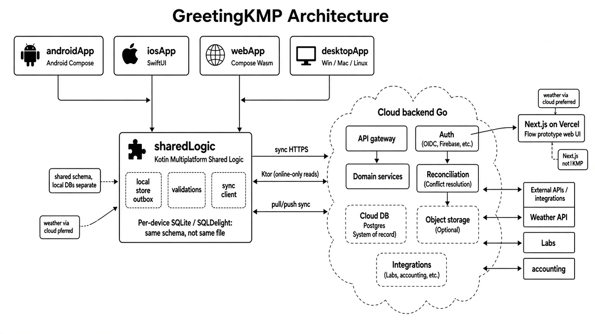
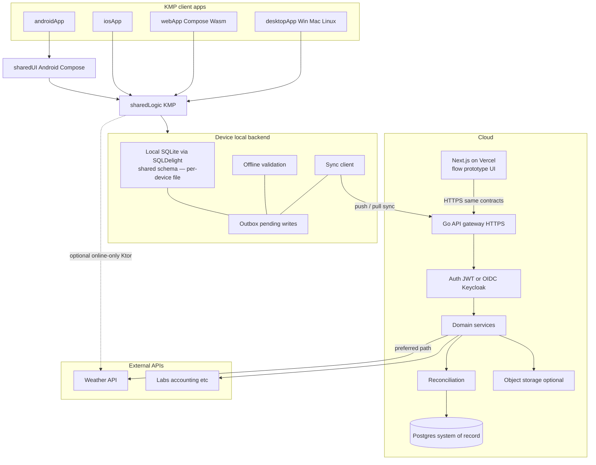
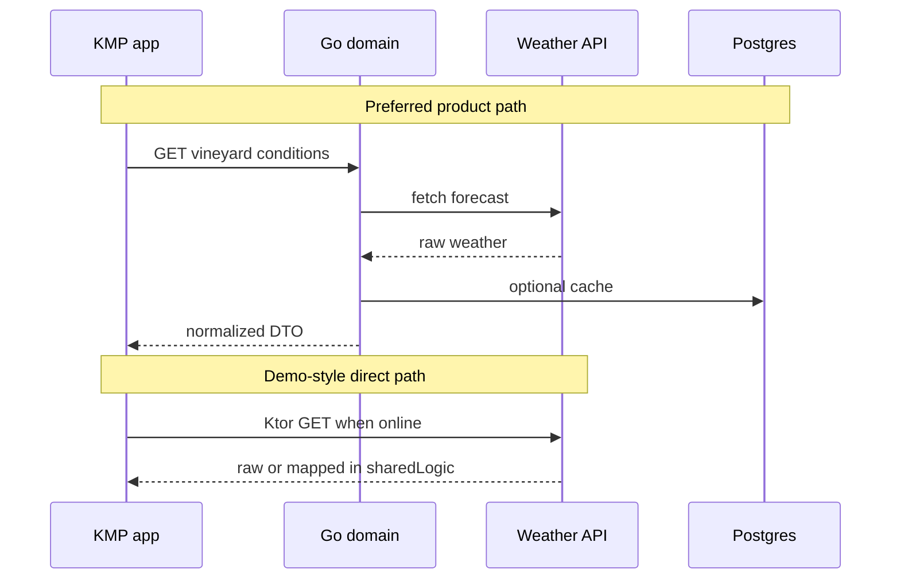
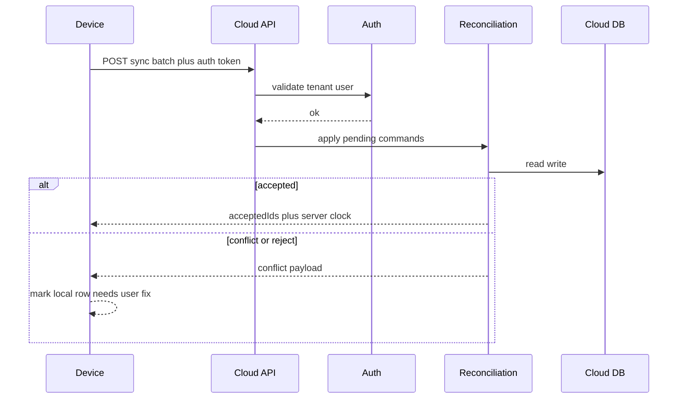
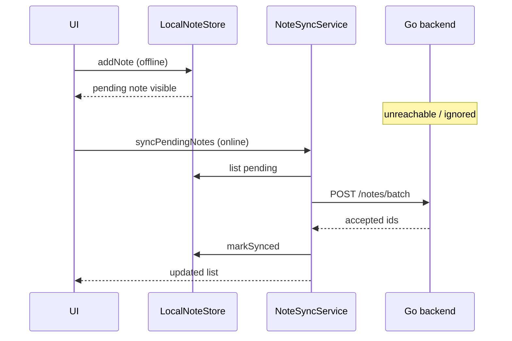

# Cloud backend vs app local backend

How a product like a **winery field app** should split responsibilities — and how that maps onto this repo.

Also see: [CONTRACTS_DOCKER_TESTING.md](CONTRACTS_DOCKER_TESTING.md) (shared contracts with Go, Docker images, Behave/Selenium vs other tests).

---

## Big idea

The cloud backend and the app “local backend” are **two runtimes with one language of meaning**.

```text
UI  →  sharedLogic (use-cases, validation, sync)
          ├─ local store   (device — works offline)
          └─ API client    →  cloud backend (system of record)
```

| | Cloud backend | App local backend |
|---|---|---|
| **Runs where** | Server / VPC | On the device |
| **In this repo** | `backend/` (Go) — optional; can stay separate | `sharedLogic` |
| **Source of truth** | Usually yes (multi-user, audit, compliance) | Working set + offline outbox |
| **Job** | Auth, tenancy, integrations, long history | Fast UX, offline writes, validate, sync |

---

## Full picture: devices + cloud

Same client layout as [PROJECT_OVERVIEW.md](PROJECT_OVERVIEW.md), expanded with cloud backend, a **Next.js / Vercel flow prototype**, and **external APIs** (weather, labs, etc.).





### Legend

| Style / box | Meaning in *this* repo today |
|-------------|------------------------------|
| Client apps + `sharedLogic` | Implemented |
| Local store + sync + Go `POST /notes/batch` | Playground demo ([OFFLINE_NOTES_DEMO.md](OFFLINE_NOTES_DEMO.md)) |
| Next.js / Vercel, Auth, Postgres, reconciliation, external APIs | **Target / prototype shape** — not all built yet |

---

## Do all apps share the same SQLDelight?

**Same schema and queries — not the same database file.**

| Layer | What is shared? | What is separate? |
|-------|-----------------|-------------------|
| **SQLDelight** (in `sharedLogic`) | `.sq` schema, generated Kotlin APIs | — |
| **Each device / install** | — | Its own SQLite file (phone A ≠ phone B ≠ desktop) |
| **Cloud** | — | Postgres (or similar) — **not** SQLDelight |

So: one **definition** of tables/queries in KMP; many **local copies** of data that sync toward the cloud SoR.

In *this* playground, notes still use an **in-memory** store; SQLDelight is declared but not wired. Wasm also needs a driver story before it matches mobile/desktop SQLite.

```text
sharedLogic SQLDelight schema
        │
        ├─ androidApp  → SQLite file on device
        ├─ iosApp      → SQLite file on device
        ├─ desktopApp  → SQLite file on machine
        └─ webApp      → (driver TBD; often cache / IndexedDB story)

cloud Postgres  → system of record (different technology)
```

---

## Next.js on Vercel (flow prototype)

Not a fifth KMP target. It sits on the **cloud / web ops** side:

- Prototypes **flows and IA** quickly (your earlier plan)
- Talks to the **same Go API contracts** the KMP apps will use
- Does **not** embed `sharedLogic` or SQLDelight
- Deployed on **Vercel**; Go API stays elsewhere (`backend/` or cloud host)

When flows stabilize, rebuild those screens in KMP UIs — keep the API.

---

## External APIs (weather, etc.) — where they connect

Two valid patterns:

| Pattern | Path | When to use |
|---------|------|-------------|
| **A. Via your Go backend** (preferred for product) | App → Go → Weather API → (optional cache in Postgres) → app | Hide API keys, rate-limit, normalize DTO, work offline from **last cached** value after sync |
| **B. Direct from `sharedLogic`** (like SpaceDevs in this demo) | App → Ktor → Weather API | Simple online-only reads; keys/CORS harder on mobile/web; no cloud cache |

Weather is an **integration** (read-mostly). It is not the system of record for barrels/notes; at most you **snapshot** “temp at time of check” into a field note and sync that snapshot.



---

## Cloud components (what each box is for)

| Cloud piece | Responsibility | Offline note |
|-------------|----------------|--------------|
| **Next.js / Vercel** | Flow / ops web prototype | Online; uses Go API |
| **API gateway** | Versioned HTTP/JSON (or gRPC), rate limits, CORS | Device talks here only when online |
| **Auth** | Identity, sessions/JWT, tenant membership | Tokens cached on device; refresh when online |
| **Domain services** | Commands/queries for lots, barrels, notes, etc. | Same vocabulary as `sharedLogic` |
| **Reconciliation** | Merge device outbox with server state; accept/reject/conflict | Cloud wins on compliance; device may re-prompt |
| **Cloud DB** | System of record, audit trail, multi-user | Not the SQLDelight file on the phone |
| **Object storage** | Photos, lab PDFs, large attachments | Upload queued in outbox |
| **External APIs** | Weather, labs, customs, accounting | Prefer Go as façade; cache what field apps need offline |

### Reconciliation in one sentence

Device sends **pending commands** → cloud applies them against the **system of record** → returns **accepted / rejected / conflict** → device updates local rows and clears or retries the outbox.



---

## Should the cloud backend live here?

| Choice | When |
|---|---|
| **Separate deployable in-repo** (`backend/`) | Same product, different language/runtime — what we demo here with Go |
| **Separate Git repo** | Different team, cadence, or scale |
| **Kotlin `:server` module** | You want one language and shared DTOs in Gradle |
| **No cloud** | Single-site offline-only — rare for multi-user SaaS |

For a winery product that starts as Next.js + Go: **keeping Go as cloud is fine**. KMP clients consume it; they do not replace it.

---

## What overlaps (share this)

| Share across cloud + clients | Cloud only | Device only |
|---|---|---|
| Domain names, IDs, enums | Billing, multi-tenant auth | UI state, caches |
| Command / DTO shapes (JSON contract) | Heavy reporting | Offline outbox / sync cursor |
| Invariants checkable offline | Labs / customs / accounting integrations | Drafts, device settings |
| Read models the UI needs | Irreversible compliance commits | Local secrets |

**Share meaning, duplicate runtime.** Do not copy the Go service into SQLDelight.

---

## Offline-first pattern (this playground)

Devices in a cellar are often **without connectivity**. The demo use case:

1. User captures a **field note** while offline → saved **locally** as `pending`.
2. App stays usable; cloud is unreachable by design (or toggled off).
3. When online, user taps **Sync** → pending notes POST to Go → marked `synced`.



Today’s Go `backend/` is only the **API + in-memory notes store** slice of the cloud diagram above (no auth / Postgres / reconciliation yet).

See also: [OFFLINE_NOTES_DEMO.md](OFFLINE_NOTES_DEMO.md).

---

## Mental rules

1. Cloud = system of record; device = cache + outbox.  
2. Offline rules may accept optimistically; cloud may still reject on sync.  
3. Overlap = **contracts + pure domain checks**, not one codebase doing both jobs.  
4. Auth and reconciliation belong in the **cloud**; the device only holds tokens and conflict UI.

---

## FAQ

### Can auth be Keycloak?

**Yes.** Keycloak is an open-source **identity provider** (OIDC/OAuth2). Your Go API verifies JWTs Keycloak issues; apps do login via Keycloak (or a thin wrapper). Fits the “Auth JWT or OIDC” box well for self-hosted / enterprise winery SaaS.

### What is Firebase?

**Google’s BaaS** (Backend-as-a-Service): Auth, Firestore (doc DB), Cloud Functions, push, storage, etc. You can use Firebase **only for Auth**, or lean on it for sync/DB too. Tradeoff: faster to start, more vendor lock-in, and offline sync semantics are *their* model—not your Go reconciliation service.

Rough map: Keycloak ≈ “bring your own IdP”; Firebase Auth ≈ “hosted IdP + optional rest of Google stack.”

### What is “system of record”?

The place that is **authoritative** when copies disagree. Example: two devices edit the same barrel note offline; after sync, **cloud Postgres** decides the canonical state (or marks a conflict). The phone DB is a working copy, not the SoR.

### What is an “integration”?

A **connection to another system** outside your core app: lab LIMS, accounting (e.g. ERP), customs, email, payment. Usually cloud-side jobs/webhooks—not something the cellar phone calls directly while offline.

### Is the device side all SQL-ish? No document DB?

**Not required to be SQL-only.** Common pattern:

| Device store | Typical use |
|--------------|-------------|
| **SQLite via SQLDelight** (relational) | Entities, outbox, sync cursors — great for KMP |
| **Document / KV** (e.g. Realm, Couchbase Lite, DataStore) | Flexible docs, or simpler prefs |
| **Files** | Photos, PDFs before upload |

Many products use **SQLite on device + Postgres in cloud**. Doc DBs on device are fine if you prefer that model; KMP’s well-trodden path is SQLDelight → SQLite.

### Is push/pull sync gRPC on the backend?

**Optional, not mandatory.** Sync is a *pattern* (push pending commands, pull server changes). Transport can be:

| Transport | When |
|-----------|------|
| **HTTPS + JSON** (what the notes demo uses) | Simplest; enough for many apps |
| **gRPC** | Strong contracts, streaming, mobile-friendly binary; good for chatty sync |
| **gRPC-Web / Connect** | Browser clients without full gRPC |

Choose gRPC when the sync protocol gets large or bidirectional streaming helps—not because “sync implies gRPC.”

### Do all apps share one SQLDelight database?

**No.** They share the **SQLDelight schema/code** in `sharedLogic`. Each install gets its **own** SQLite file. Cloud SoR is separate (e.g. Postgres).

### Where does Next.js / Vercel sit?

On the **cloud web** side as a **flow prototype** (and maybe later an ops console). It calls Go over HTTPS. It is not a KMP client and does not use SQLDelight.

### Where does a weather API sit?

Under **External APIs**. Prefer **Go → weather → (cache) → apps**. Direct **Ktor from `sharedLogic`** is fine for online-only demos (similar to the SpaceDevs rocket call).

---

## Mapping onto GreetingKMP

| Piece | Location | Status |
|---|---|---|
| Local store + sync use-case | `sharedLogic` (`FieldNote`, `LocalNoteStore`, `NoteSyncService`) | Demo |
| Cloud API (notes batch) | `backend/` (Go) | Demo (in-memory) |
| Client UIs | `androidApp` / `iosApp` / `webApp` / `desktopApp` | Demo |
| SQLDelight shared schema | `sharedLogic` | Declared; not wired |
| Next.js / Vercel prototype | Separate app → Go API | Planned |
| Auth, Postgres, reconciliation, weather façade | Future `backend/` | Not built |
