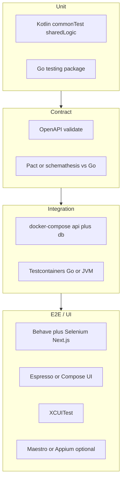

# Shared logic, Docker, and testing

Answers three design questions while **keeping a Go backend**:

1. How to avoid duplicating local vs cloud storage logic  
2. What from the full diagram is dockerizable / registry-publishable  
3. How to test each part (and where Behave + Selenium fit)

Related: [CLOUD_VS_LOCAL_BACKEND.md](CLOUD_VS_LOCAL_BACKEND.md) · [PROJECT_OVERVIEW.md](PROJECT_OVERVIEW.md)

---

## 1. Single logic for local + cloud storage (with Go)

### Honest constraint

You **cannot** run one SQLDelight/SQLite engine as both the phone DB and the Go system of record. Runtimes differ (Kotlin/Native/JVM/Wasm vs Go + Postgres).

What you *can* make single is the **meaning**: commands, DTOs, invariants, and acceptance rules.

```text
                    ┌─────────────────────────┐
                    │  Contracts (single)     │
                    │  OpenAPI / proto / JSON │
                    │  Schema + golden cases  │
                    └───────────┬─────────────┘
                                │
          ┌─────────────────────┼─────────────────────┐
          ▼                     ▼                     ▼
   Kotlin sharedLogic      Go domain + DB      Next.js client
   SQLDelight adapter      Postgres adapter    HTTP only
   (local outbox)          (system of record)
```

### Pattern that keeps Go and avoids “two brains”

| Layer | Single source? | Where |
|-------|----------------|--------|
| **API contracts** (paths, DTOs, errors) | Yes | OpenAPI or protobuf in repo (`contracts/` or generated from one side) |
| **Pure domain rules** (e.g. “barrel can’t be in two places”) | Yes if encoded as tests/spec; or Kotlin for offline + Go must re-check | Shared **spec + contract tests**, not shared binary |
| **Storage engines** | No | SQLDelight/SQLite on device; Postgres in Go |
| **Repository / use-case orchestration** | Parallel shapes, same verbs | `NotesFacade` / sync in Kotlin ↔ handlers in Go |

**Recommended shape**

1. Define **commands** once: `UpsertNote`, `SyncBatch`, … in OpenAPI.  
2. Kotlin: `NoteRepository` interface → `SqlDelightNoteRepository` + `HttpNoteSync`.  
3. Go: same HTTP handlers → Postgres.  
4. **Contract tests** prove Go and Kotlin agree (see below).  
5. Offline validation lives in Kotlin (must work without network); Go **re-validates** on sync (never trust the device alone).

That is “no duplicated *product* logic” in practice: one contract, two thin adapters. Duplicating a few pure checks in Go is normal and safer than sharing a DB engine.

### What *not* to chase

- Generating Go from SQLDelight or vice versa as the SoR  
- Calling Kotlin from Go (or Go from the phone) for every write  
- One SQLite file mounted by both cloud and devices  

---

## 2. What is dockerizable (and pushed to a registry)?

| Diagram piece | Docker image? | Registry? | Notes |
|---------------|---------------|-----------|--------|
| **Go API** (`backend/`) | Yes | Yes | Primary service image |
| **Postgres** | Yes (official) | Pull official / mirror | Stateful; use volumes |
| **Keycloak** (auth) | Yes | Pull official | Often compose profile `auth` |
| **Object storage** (MinIO stand-in for S3) | Yes | Pull / build | Dev/staging |
| **Next.js** flow prototype | Optional | Optional | Prod often **Vercel** (no image); Docker useful for self-host or CI |
| **WireMock / mock weather** | Yes | Pull | Integration tests |
| **Nginx** serving Wasm `webApp` static | Optional | Yes | After `wasmJsBrowserDistribution` |
| **KMP androidApp / iosApp / desktopApp** | Not as “the product” | — | CI agents may use images; apps ship as APK/IPA/DMG |
| **sharedLogic / SQLDelight** | No | — | Library inside apps, not a service |
| **External weather/labs APIs** | No | — | Third-party; mock in tests |

### Typical `docker-compose` for local cloud

```text
services:
  api          → your Go image (registry.example.com/winery-api:tag)
  db           → postgres:16
  keycloak     → quay.io/keycloak/keycloak (optional profile)
  minio        → minio/minio (optional)
  wiremock     → wiremock/wiremock (weather stub)
  web-prototype→ next.js image OR run via Vercel CLI locally
```

Publish to a registry only what you **deploy or run in CI as services**. Mobile/desktop artifacts use Play/App Store/notarization—not usually the same container registry.

---

## 3. How to test each part



### Matrix

| Part | What to test | Tooling (examples) |
|------|----------------|--------------------|
| **sharedLogic** domain + sync | Pending → sync → mark synced; validation | Kotlin `commonTest` (JVM), optional android/ios tests |
| **SQLDelight** | Queries, migrations | JVM driver in unit tests; or android instrumented |
| **Go API** | Handlers, reconciliation, auth middleware | `go test`, table-driven tests |
| **Go + Postgres** | Real SQL, migrations | docker-compose / Testcontainers |
| **Contracts** | Kotlin client and Go server still match | OpenAPI CI check; Pact; Schemathesis fuzzing the API |
| **Next.js prototype** | Flows in the browser | **Behave + Selenium** (or Playwright + BDD) |
| **Android UI** | Screens over fakes | Compose UI tests / Espresso |
| **iOS UI** | Screens over fakes | XCUITest |
| **Desktop** | Smoke | Manual + limited UI tests |
| **Wasm webApp** | Smoke in browser | Playwright against `wasmJsBrowserDevelopmentRun` |
| **Full offline path** | Toggle offline, add, online, sync | Maestro/Appium **or** desktop E2E hitting local Go |

### Behave + Selenium — for what?

**Best fit:** the **Next.js / Vercel flow prototype** (and any future ops web UI).

| Use Behave + Selenium for | Don’t stretch it to |
|---------------------------|---------------------|
| Browser user journeys (“add note”, “sync”, login) | Native iOS/Android (use XCUITest / Espresso / Maestro) |
| BDD specs stakeholders can read | Replacing Go unit tests |
| Regression on web flows against dockerized Go | Proving SQLDelight internals |

**Equivalents**

| Goal | Alternative |
|------|-------------|
| BDD web | Behave+Selenium, Cucumber+Playwright, Robot Framework |
| Web E2E without BDD | Playwright or Cypress alone |
| Mobile E2E + BDD | Appium + Cucumber; or Maestro (YAML flows, less BDD) |
| API BDD | Behave hitting HTTP only (no browser)—often enough for sync contracts |

### Suggested pyramid for this product

1. **Lots:** Go + Kotlin unit tests  
2. **Some:** Contract tests on OpenAPI  
3. **Some:** API + Postgres in Docker  
4. **Few:** Behave/Selenium on Next.js against compose stack  
5. **Few:** Critical mobile paths (Maestro) once apps matter  

---

## Practical “definition of done” for shared storage logic

- [ ] OpenAPI (or proto) checked into repo and validated in CI  
- [ ] Kotlin maps DTOs ↔ domain; Go maps same DTOs ↔ Postgres  
- [ ] Golden examples: same JSON fixtures used by both sides’ tests  
- [ ] Sync acceptance cases: accept / reject / conflict covered in Go + Kotlin  
- [ ] docker-compose brings up API + DB for local and CI  

That is how you keep **one product logic** without forcing **one storage runtime**—and still keep Golang.
