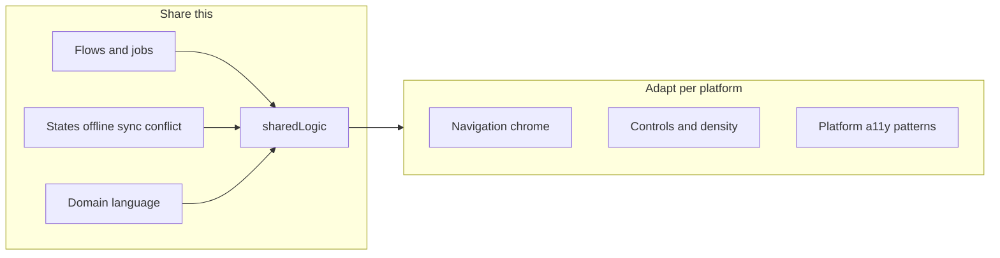

# Multiplatform UI design notes

Guidance for designing UIs across **Android, iOS, web, and desktop** when you are a software engineer first (not a full-time app designer). Maps onto this repo’s split: **shared flows in `sharedLogic`, independent UIs per app**.

Related: [PROJECT_OVERVIEW.md](PROJECT_OVERVIEW.md) · [CLOUD_VS_LOCAL_BACKEND.md](CLOUD_VS_LOCAL_BACKEND.md)

---

## Core rule

> Same **verbs and outcomes**, different **controls and navigation**.

Share product meaning (jobs, states, domain language). Do **not** require pixel-identical screens. A “web-looking” iOS app feels wrong even when the logic is perfect.

---

## What this repo already does

| App | UI stack | Shares UI with others? |
|-----|----------|------------------------|
| `androidApp` | Compose via `sharedUI` | Only Android (today) |
| `iosApp` | SwiftUI | No |
| `webApp` | Compose Wasm | No |
| `desktopApp` | Compose Desktop | No |

All of them call the same **use-cases** in `sharedLogic` (greetings, offline notes, sync). That is the right seam.



---

## 1. Design the product once, the chrome per platform

**Lock across platforms**

- Jobs to be done (e.g. “log barrel check offline → sync later”)
- Information architecture (screens, entities, status: pending / synced / conflict)
- Copy and domain vocabulary
- Empty / loading / error / offline / conflict states

**Vary per platform**

- Navigation (tabs vs sidebar vs nav bar)
- Controls (Material vs SwiftUI vs pointer menus)
- Density (thumb-first phone vs mouse + keyboard desktop)

If a feature needs a *different workflow* per platform, treat that as a product smell—usually one flow with adapted chrome is enough.

---

## 2. Respect platform conventions

| Concern | iOS | Android | Web | Desktop |
|---------|-----|---------|-----|---------|
| Navigation | Large titles, edge back-swipe | System back / up, use FAB sparingly | Real URLs + browser back | Menus, multi-window, shortcuts |
| Dialogs | Sheets / alerts | Material dialogs | Modals sparingly | Native dialogs / panels |
| Lists | Native list feel | Same idea, Material list | Virtualize long lists | Tables, multi-select, sorting |
| Input | Soft keyboard, focus rings | IME + keyboard | Forms, focus order | Tab order, accelerators |

Users notice “wrong platform” faster than they notice brand color mismatches.

---

## 3. Environment beats visual polish (field apps)

Especially for cellar / outdoor use:

- **Gloves / cold / sun** → large targets, high contrast, few precision gestures
- **One-hand phone** vs **tablet / desktop with keyboard**
- **Offline as a first-class mode** — status always visible; never block capture on “no network”
- **Camera / photos** — permission and picker UX differ per OS; plan them explicitly
- **Safe areas**, notches, keyboard covering fields

Test on **real devices** in the real environment (brightness, offline, fat fingers). Emulators lie.

---

## 4. What to share vs not

| Share (`sharedLogic` + specs) | Don’t force-share |
|-------------------------------|-------------------|
| Validation, sync, models, permissions (“can user do X?”) | Exact layouts and navigation chrome |
| Screen *flow* diagrams and state machines | One Compose UI for all platforms unless you *choose* that product bet |
| High-level tokens (spacing scale, status colors: pending/synced/error) | Copying Material 1:1 onto iOS (or the reverse) |

Optional later: share more UI via Compose Multiplatform where the product *wants* sameness (e.g. internal tools). Field-facing iOS often still wins with SwiftUI.

---

## 5. Spec screens as states + actions

Prefer this over Figma-only handoff:

```text
Screen: Field notes
States: empty | list | offline banner | syncing | conflict
Actions: addNote | toggleOnline | sync | openConflict
Outcomes: note PENDING locally | SYNCED after cloud accept | conflict needs user
```

Same state machine on every client; only widgets change. That matches how `NotesFacade` / sync already work in this playground.

---

## 6. Accessibility and responsiveness

- **Dynamic Type / font scaling** (iOS) and Android font scale
- TalkBack / VoiceOver labels on icon-only controls
- Contrast that survives sunlight
- **Responsive ≠ stretch a phone layout** — desktop needs density, multi-pane, keyboard shortcuts
- Web: semantic headings, keyboard, focus visible

---

## 7. Priority order (if you are not a UI specialist)

1. Flows + states (including offline / sync / conflict)  
2. Platform-native navigation  
3. Touch / keyboard ergonomics  
4. Visual brand consistency (type, color)  
5. Pixel polish  

Own **1–3** in engineering. Partner or hire for **4–5** when brand matters.

---

## 8. Practical checklist before building four UIs

- [ ] One flow prototype (even ugly web) agreed with stakeholders  
- [ ] State list includes offline and conflict  
- [ ] Navigation sketch per platform (not one wireframe forced everywhere)  
- [ ] Primary actions reachable with thumbs on phone; shortcuts planned on desktop  
- [ ] Sync status visible without opening a hidden settings screen  
- [ ] Permissions (camera, network) documented per OS  
- [ ] `sharedLogic` API stable enough that UIs stay thin  

---

## Mapping onto GreetingKMP

| Concern | Where it lives |
|---------|----------------|
| Shared behavior | `sharedLogic` |
| Android UI | `sharedUI` / `androidApp` |
| iOS UI | `iosApp` (SwiftUI) |
| Web UI | `webApp` |
| Desktop UI | `desktopApp` |
| Offline notes demo | [OFFLINE_NOTES_DEMO.md](OFFLINE_NOTES_DEMO.md) |

**Remember:** sharing UI frameworks is optional; sharing **jobs, states, and domain** is not.
