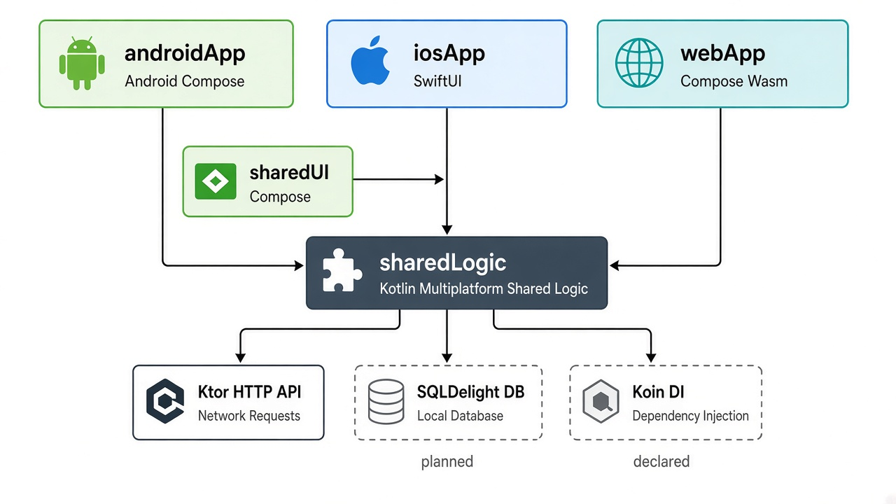
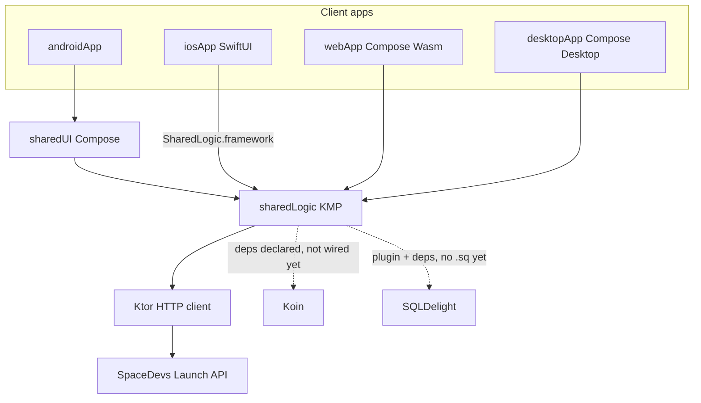
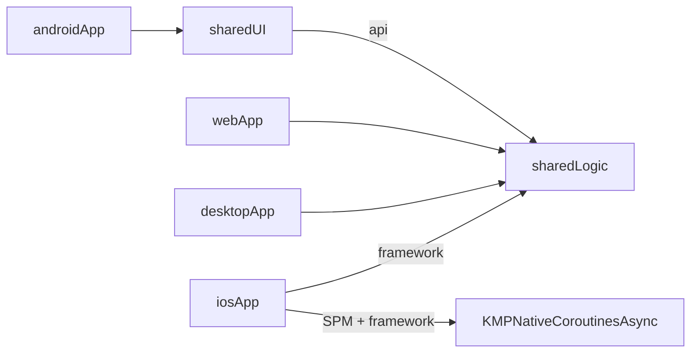
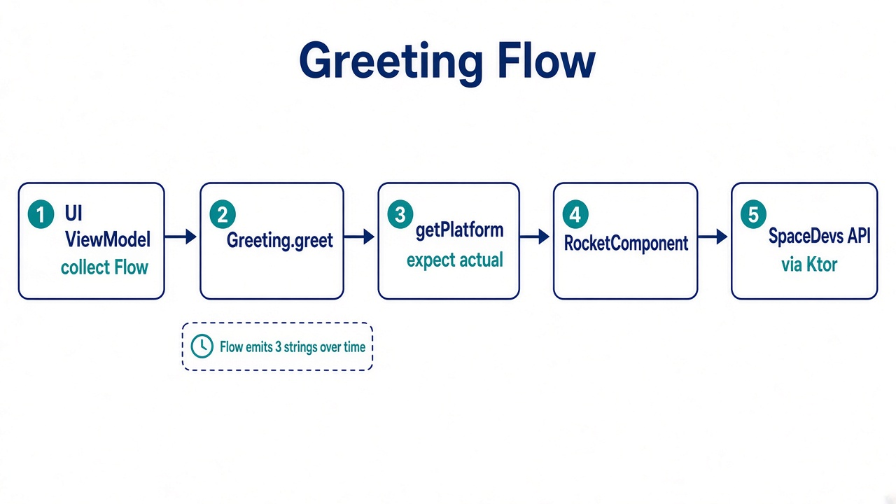
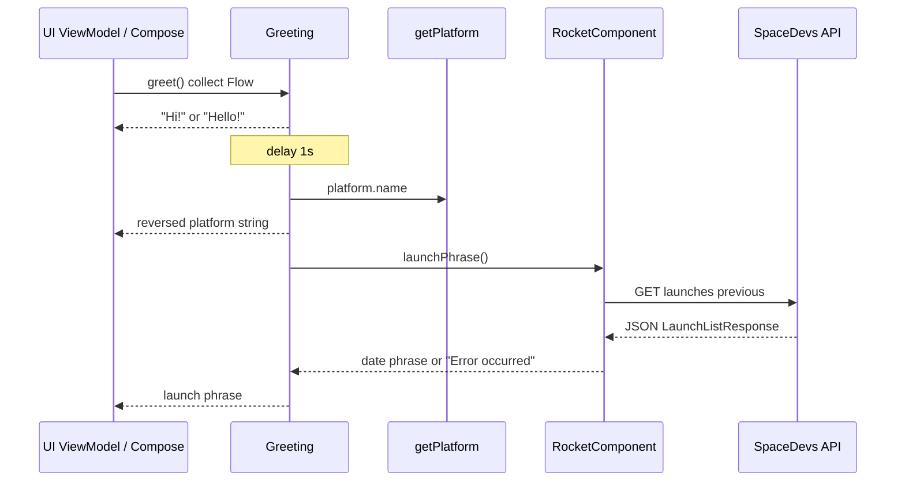
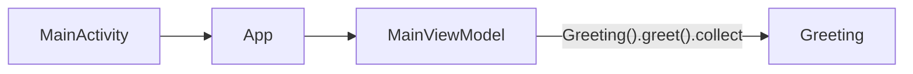
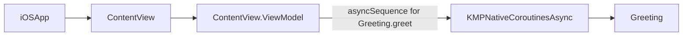
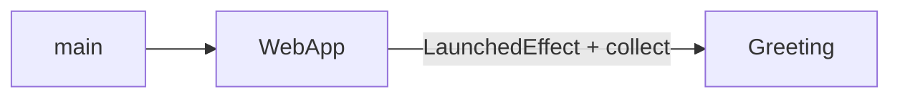
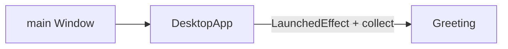
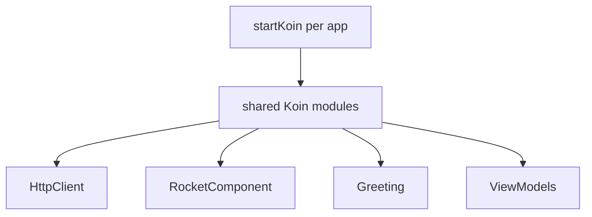

# GreetingKMP — Project Overview

Easy map of **modules**, **dependencies**, **runtime communication**, and **injection** as the project stands today.

---

## 1. Big picture

Four client apps share one Kotlin logic library. UIs are **not** all shared:

| Client | UI technology | How it reaches shared code |
|--------|---------------|----------------------------|
| **androidApp** | Jetpack Compose via `sharedUI` | Gradle project dependency |
| **iosApp** | Native SwiftUI | `SharedLogic.framework` + KMP-NativeCoroutines |
| **webApp** | Compose Multiplatform (Wasm) | Gradle project dependency on `sharedLogic` |
| **desktopApp** | Compose Desktop (JVM) | Gradle project dependency on `sharedLogic` |





---

## 2. Repository layout

```text
GreetingKMP/
├── androidApp/          # Android entry (MainActivity → App())
├── iosApp/              # Xcode + SwiftUI entry
├── webApp/              # Kotlin/Wasm + Compose entry
├── desktopApp/          # Windows / macOS / Linux Compose Desktop entry
├── sharedUI/            # Android Compose UI + MainViewModel
├── sharedLogic/         # Business logic shared by all platforms
├── gradle/libs.versions.toml
└── docs/                # This documentation
```

### Targets inside `sharedLogic`

| Source set | Platform |
|------------|----------|
| `commonMain` | Shared Kotlin |
| `androidMain` | Android |
| `iosMain` (`iosArm64` / `iosSimulatorArm64`) | iOS |
| `wasmJsMain` | Browser (WebAssembly) |
| `jvmMain` | Desktop JVM (Win / Mac / Linux) |

`expect` / `actual` example: [`Platform.kt`](../sharedLogic/src/commonMain/kotlin/com/jetbrains/greetingkmp/Platform.kt) → Android / iOS / Wasm / JVM implementations.

---

## 3. Tools & versions

Pinned in [`gradle/libs.versions.toml`](../gradle/libs.versions.toml):

| Tool | Version | Role |
|------|---------|------|
| Kotlin | 2.4.20 | Language + KMP |
| Android Gradle Plugin | 9.1.1 | Android builds |
| Compose Multiplatform | 1.12.1 | Android `sharedUI` + Wasm `webApp` |
| Material3 (CMP) | 1.12.0-alpha03 | UI components |
| kotlinx.coroutines | 1.11.0 | Async / `Flow` |
| kotlinx.datetime | 0.8.0 | Dates in launch phrase |
| Ktor | 3.5.2 | HTTP client |
| KMP-NativeCoroutines | 1.0.6 | Expose `Flow` to Swift `AsyncSequence` |
| Koin | 4.2.2 | DI (**declared, not started yet**) |
| SQLDelight | 2.3.2 | Local DB (**declared, no schema yet**) |

### Gradle plugins on `sharedLogic`

- `kotlinMultiplatform`
- `androidMultiplatformLibrary`
- `kotlinSerialization`
- `kmpNativeCoroutines`
- `sqldelight` (plugin applied; databases block / `.sq` files not present yet)

### IDE / run tooling

| App | How to run |
|-----|------------|
| Android | IDE run config or `./gradlew :androidApp:assembleDebug` |
| iOS | Open `iosApp` in Xcode |
| Web | `./gradlew :webApp:wasmJsBrowserDevelopmentRun` → browser (~`http://localhost:8080`) |
| Desktop | `./gradlew :desktopApp:run` (packages: `:desktopApp:packageDistributionForCurrentOS`) |

---

## 4. Module dependencies



### What each module depends on

**`sharedLogic` (common)**  
Coroutines, datetime, Ktor core + content negotiation + JSON, SQLDelight runtime, Koin core.

**`sharedLogic` (per platform engines)**

| Target | Extra deps |
|--------|------------|
| Android | `ktor-client-android`, `sqldelight-android-driver` |
| iOS | `ktor-client-darwin`, `sqldelight-native-driver` |
| Wasm | `ktor-client-js` *(no SQLDelight Wasm driver yet)* |
| JVM / Desktop | `ktor-client-cio`, `sqldelight-sqlite-driver` |

**`sharedUI`**  
`api(sharedLogic)` + Compose runtime/foundation/material3/ui/resources + AndroidX lifecycle ViewModel Compose.

**`androidApp`**  
`sharedUI` + Activity Compose.

**`webApp`**  
`sharedLogic` + Compose (Wasm) + coroutines. Own UI — does **not** use `sharedUI`.

**`desktopApp`**  
`sharedLogic` + Compose Desktop (`compose.desktop.currentOs`). Own UI — does **not** use `sharedUI`. One binary covers Windows, macOS, and Linux.

**`iosApp`**  
SwiftUI + `SharedLogic` framework + Swift packages `KMPNativeCoroutinesAsync` / `KMPNativeCoroutinesCore`.

---

## 5. Runtime communication

### Greeting data flow





Core types:

- [`Greeting`](../sharedLogic/src/commonMain/kotlin/com/jetbrains/greetingkmp/Greeting.kt) — builds a `Flow<String>`
- [`RocketComponent`](../sharedLogic/src/commonMain/kotlin/com/jetbrains/greetingkmp/RocketComponent.kt) — owns an `HttpClient`, fetches launch data
- [`RocketLaunch`](../sharedLogic/src/commonMain/kotlin/com/jetbrains/greetingkmp/RocketLaunch.kt) — `@Serializable` models

External API:

```text
GET https://lldev.thespacedevs.com/2.3.0/launches/previous/?mode=list&limit=10&format=json
```

**Web note:** browsers enforce CORS. That call may fail in Wasm and surface as `"Error occurred"` while Android/iOS still succeed.

---

## 6. How each UI talks to shared logic

### Android (`sharedUI`)



- `MainViewModel` is an AndroidX `ViewModel`
- Created with Compose `viewModel()` (lifecycle-aware factory — **not Koin**)
- Exposes `StateFlow<List<String>>` to the UI

### iOS (`iosApp`)



- `@NativeCoroutines` on `greet()` makes the Kotlin `Flow` usable from Swift
- Swift: `asyncSequence(for: Greeting().greet())`
- Manual `ContentView(viewModel: ContentView.ViewModel())` — **no DI container**

### Web (`webApp`)



- Compose state list updated as the `Flow` emits
- Instantiates `Greeting()` directly — **no DI container**

### Desktop (`desktopApp`)



- Same greeting-list pattern as web, on JVM Compose Desktop
- Instantiates `Greeting()` directly — **no DI container**
- No CORS issues (native HTTP via Ktor CIO), unlike the browser

---

## 7. Injections / object creation (current reality)

Today the project uses **manual construction**, not a DI graph.

| Object | Who creates it | Injected? |
|--------|----------------|-----------|
| `Greeting` | Each ViewModel / `WebApp` / `DesktopApp` via `Greeting()` | No |
| `RocketComponent` | Inside `Greeting` via `RocketComponent()` | No |
| `HttpClient` | Inside `RocketComponent` | No |
| Android `MainViewModel` | Compose `viewModel()` | Lifecycle factory only |
| iOS `ViewModel` | `ContentView.ViewModel()` in `iOSApp` | No |

### Koin status

- `koin-core` is on `sharedLogic` common classpath
- `koin-androidx-compose` is in the version catalog
- **No** `startKoin`, **no** `module { }`, **no** `by inject()` yet

Intended future shape (not implemented):



### SQLDelight status

- Plugin + runtime + Android/Native drivers declared
- **No** `.sq` files, **no** `sqldelight { databases { ... } }` config in Gradle yet
- Wasm has **no** SQLDelight driver dependency yet

Treat Koin and SQLDelight as **prepared dependencies**, not active architecture.

---

## 8. Platform bridges worth knowing

| Concern | Mechanism |
|---------|-----------|
| Platform name | `expect fun getPlatform()` / `actual` per target |
| Kotlin `Flow` → Swift | `@NativeCoroutines` + `KMPNativeCoroutinesAsync` |
| Kotlin → ObjC/Swift names | `optIn(ExperimentalObjCName)` available module-wide |
| JSON over HTTP | kotlinx.serialization + Ktor ContentNegotiation |
| Wasm UI host | `ComposeViewport` + webpack `webApp.js` |

---

## 9. Quick “where do I change X?”

| Goal | Place |
|------|--------|
| Shared business / networking | `sharedLogic` |
| Android list UI | `sharedUI` (`App.kt`, `MainViewModel.kt`) |
| iOS list UI | `iosApp/.../ContentView.swift` |
| Web list UI | `webApp/.../WebApp.kt` |
| Desktop list UI | `desktopApp/.../DesktopApp.kt` |
| Versions | `gradle/libs.versions.toml` |
| New shared dependency | `sharedLogic/build.gradle.kts` (+ catalog if needed) |

---

## 10. Honest maturity snapshot

| Area | State |
|------|--------|
| Shared greeting + HTTP flow | Working |
| Android / iOS / Web / Desktop clients | Working |
| Independent UIs (iOS + Web + Desktop) | Working |
| Koin DI | Declared only |
| SQLDelight persistence | Declared only |
| Web CORS for launch API | Likely fails in browser |

---

*Generated from the repo layout and build files. Update this doc when Koin modules or SQLDelight schemas land.*
